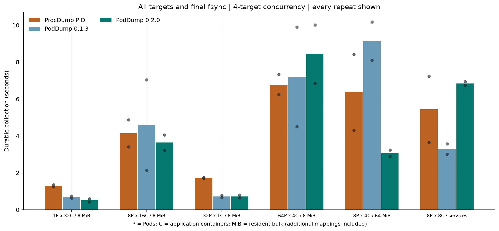
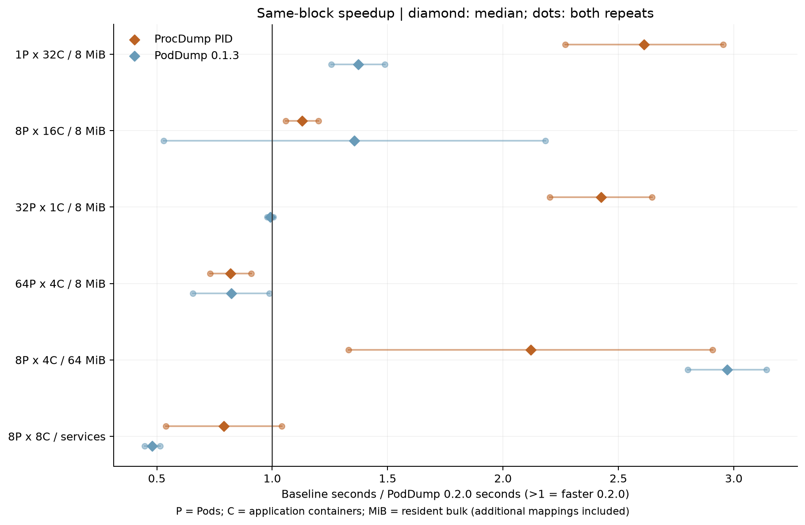
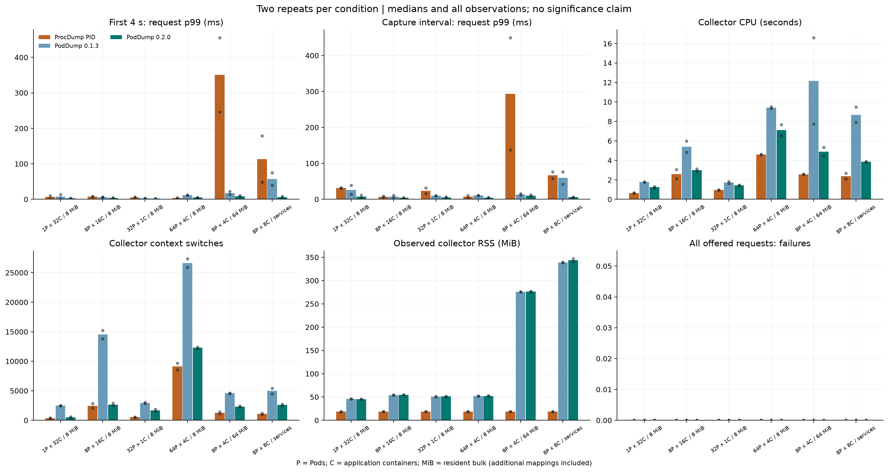
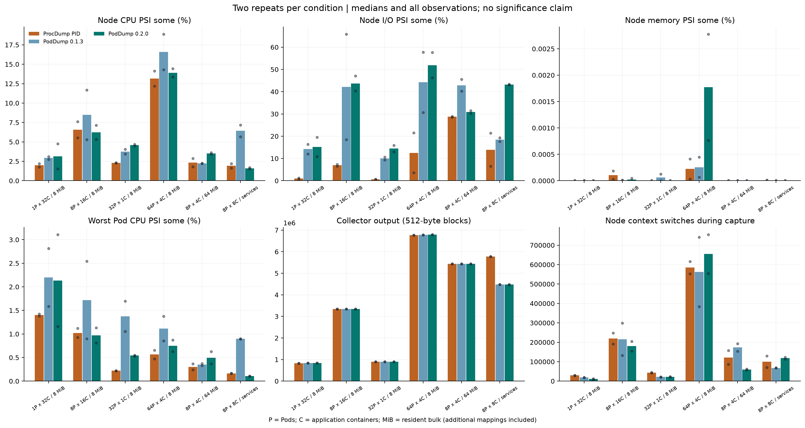

# Whole-Pod speed comparison

These measurements used PodDump 0.2.0. Version 0.2.1 changes CLI presentation
and aliases; its live output demonstration is documented separately.

The 48 complete comparison runs tested six workload shapes, two repeats, tuned
ProcDump PID workers, the previous PodDump 0.1.3, PodDump 0.2.0, and a
no-collection control. Both collectors captured the same Pod process sets
with the matched `legacy32` mapping policy and a global 4-target limit.
Timing includes final file and directory synchronization. One additional
attempt had an incomplete load-generator record and is retained separately;
a control-file publication fix preceded its replacement, with the collector
binary and measurement settings unchanged (49 attempts in total).

| Workload | ProcDump PID (s) | PodDump 0.1.3 (s) | PodDump 0.2.0 (s) | Paired speedup |
| --- | ---: | ---: | ---: | ---: |
| 1 Pod × 32 containers / 8 MiB resident bulk per app process | 1.297 | 0.687 | 0.508 | 2.61× (2.27–2.95) |
| 8 Pods × 16 containers / 8 MiB resident bulk per app process | 4.139 | 4.589 | 3.637 | 1.13× (1.06–1.20) |
| 32 Pods × 1 container / 8 MiB resident bulk per app process | 1.730 | 0.713 | 0.720 | 2.42× (2.20–2.65) |
| 64 Pods × 4 containers / 8 MiB resident bulk per app process | 6.774 | 7.199 | 8.436 | 0.82× (0.73–0.91) |
| 8 Pods × 4 containers / 64 MiB resident bulk per app process | 6.365 | 9.141 | 3.066 | 2.12× (1.33–2.91) |
| 8 Pods × 8 containers / nginx+Redis | 5.437 | 3.293 | 6.843 | 0.79× (0.54–1.04) |

Times are two-repeat medians; speedup is the median of same-block
ProcDump/PodDump 0.2.0 ratios. The range contains both observed ratios.
This is a single 8-vCPU/12-GiB VMware node, not a claim about every cluster.
MiB labels describe the seeded resident bulk; other fixture mappings,
stacks, libraries, child processes and sandbox processes are also included.
One Pod with 32 containers was 2.27–2.95× faster than ProcDump and
1.26–1.49× faster than 0.1.3. At 64 Pods, 0.2.0 lost to ProcDump in both
repeats; nginx/Redis also regressed against 0.1.3 in both repeats.
Synthetic output sizes matched exactly. Dynamic service mappings differed
slightly; the second optimized service run was 0.85% larger than 0.1.3.
See the experimental design, per-repeat results and costs below
for workload details, PSI, CPU, context switches, request latency and limits.
The 0.2.0 candidate also passed 20 offline unit tests and eight controlled
persistence/cancellation interventions. 

## Experimental design

- Final population: 48 runs = 6 conditions × 4 arms × 2 blocks; 12 controls and 36 collections.
- Total attempts: 49. The incomplete `optimized_final_017` retained 384 cores and 11.143 s collection time, but the load client crashed reading a partially published completion marker. Raw requests were unavailable, so latency/failures cannot be inferred. The original evidence is preserved separately.
- Only completion-marker publication changed to atomic rename. The first 16 observations retain the v1 protocol; the remaining 32 use v2. A fresh ID replaces that one incomplete observation in the complete paired population. Collector binaries, targets, load and timing boundaries are unchanged.
- 8 vCPU, 12 GiB, Ubuntu24.04, Linux6.8, Kubernetes/containerd/cgroup-v2 on one VMware node.
- Maximum: 64 Pods × 4 app containers = 256 app containers, 320 app TGIDs plus 64 sandbox TGIDs.
- 1×32, 32×1 and 8×16 topologies; 8×4 with 64 MiB resident bulk per app process; 8×8 actual nginx/Redis.
- Services: 32 nginx + 32 Redis endpoints; each Redis owns 1024 unique 32 KiB values; 20 requests/s/endpoint.
- Synthetic workloads: 10 requests/s/app target, 3-thread fixtures, child processes and sandbox included.
- Stock baseline: one invocation per PID, `-mc 32 -pf 1`, globally 4 workers. The PID list is supplied before timing.
- PodDump: UID discovery included in timing, global 4 process workers and 512 MiB snapshot admission across concurrent invocations.
- All files/directories are synchronized before the common end timestamp. Compression, export and offline analysis are outside the timer.
- The guest uses the existing VM disk on host C; retained evidence lives on D under KKudroK. No D export cost is counted as guest collection time.
- Randomized order within each block. Both repeats and all regressions remain. Two repeats are descriptive, not a significance test.
- Earlier 33 calibration, 43 interrupted baseline, 2 strace, 12 unsuccessful defer-only and 16 async proof runs are separate populations.
- Fresh PGID repeats were removed before final execution to focus on the requested repeated-PID-call comparison. Earlier PGID evidence remains separate.

## Why the implementation changed

The previous worker waited for each core fsync before acquiring the next
process. Simply moving those waits after capture did not help: the first
candidate was slower than 0.1.3 in both 1×32 trials. Those failed experiments
were retained. The selected implementation starts data writeback while
capture workers proceed and still checks the original write descriptors
at a final persistence barrier. Fresh 0.1.3 runs provide a contemporaneous
baseline after the storage relocation. They do not remove all variation
in host storage, scheduling or background activity. Regressions are retained.

## Availability and resource costs

All scheduled open-loop arrivals are retained, including failed/unsent
requests. Failures count as infinite latency. Capture intervals, fixed
first 4 s/1 s windows and 5 s recovery are reported separately. PSI uses each
counter read-window midpoint interval; system CPU full is undefined.
Collector, orchestration, observer and load-generator CPU are separate.
RSS is a common 50 ms sampled process-tree sum and may miss short peaks.
Logical MiB/s includes sparse file regions and file metadata; it is not a
physical disk throughput measurement. Allocated bytes and block I/O are separate.
Native internal stop times are not equivalent to sampled stock T/t states.
Faster collection does not imply lower values for every cost metric.

## Evidence and reproduction

- Measured candidate SHA-256: `3c2e65b48c3e6a51d2b1bd2e9bb4e1cef27d9c2d42fa7b5864be8b55e630912d`.
- Repaired acquisition protocol SHA-256: `a73f5c6fbebbd57838262bd24a14c23bada63819075d3ae26d05cacd1c2491df`.
- Final schedule SHA-256: `1b5a7dda25a8ee724d528088e4bcc1a5c9b2cb7da46dd76c8279b9fbae630f4e`.
- Audited cores: 4902; thread contexts: 13062.
- Offered requests: 1747200; failures: 0.
- [Machine-readable verified summary](../benchmarks/scale_summary.json) contains all aggregate values and paired repetitions.
- [Frozen acquisition protocol](../benchmarks/protocol.json) and [schedule](../benchmarks/schedule.json) preserve the design.
- [Per-run v1/v2 execution binding](../benchmarks/execution.json) and [original protocol](../benchmarks/protocol_v1.json) retain the single harness repair and incomplete attempt.
- Original cores, same-run ground truth, raw requests/counters, source archives and SHA receipts remain in the experiment evidence store; they are not embedded in this source repository.
- Native source, Cargo lockfile, vendored dependencies and embedded build provenance are retained. A relocated build can differ byte-for-byte because compiler paths are embedded.
- Each process is captured independently. The result is not a Pod/node atomic snapshot or a proof of application-heap consistency.

## Observed stage interpretation

PodDump 0.2.0 final campaign: descriptive stage interpretation

Source: [stage measurements](../benchmarks/stage_review.json), computed only from the 48 complete original observations and their native manifests. No extra experiment was run. The failed observation optimized_final_017 remains separately preserved; its 11.142996s collection duration does not supply a complete service observation.

The principal single-Pod result is repeatable in this sample. For one Pod with 32 application containers, 40 application processes plus the sandbox, optimized durable completion was 0.596/0.421s, versus stock PID workers 1.352/1.243s (2.27x/2.95x) and original PodDump 0.748/0.626s (1.26x/1.49x). All three arms produced exactly 426,188,800 logical core bytes in each repetition. Optimized discovery took 4.2/6.8ms; the following interval to first attach was 3.8/2.7ms. Final Pod durability tails were only 11.2/1.3ms. The changed storage schedule provides a real additional gain over the original collector here.

The resident-heavy 8-Pod x 4-container condition also improved in both repetitions: optimized 3.239/2.894s versus original 10.174/8.108s and stock 4.310/8.419s. Each arm produced exactly 2,782,167,040 logical core bytes. Node I/O some pressure accumulated 0.988/0.917s for optimized versus 4.101/3.699s for original. This supports a useful storage-scheduling gain for this condition, with substantial variation in the stock measurements.

The gain is not uniform. In 32 small Pods optimized was 0.648/0.792s versus original 0.651/0.775s: essentially unchanged or slightly worse, despite beating stock 1.715/1.745s. Do not attribute the entire stock gap to version 0.2.0. In 8 Pods x 16 containers optimized beat stock twice (3.222/4.052s versus 3.412/4.867s), but original varied strongly (7.035/2.143s), so the new change regressed against original in block 2.

At 64 Pods x 4 containers the optimized collector was slower than stock twice: 10.018/6.855s versus 7.318/6.231s. Original took 9.897/4.500s. The exact logical core size was 3,466,854,400 bytes for all arms. Optimized discovery summed across 64 invocations to 0.888/0.871s. The post-discovery-to-first-attach intervals summed to 1.426/0.494s, with per-Pod maxima 0.404/0.049s. This interval includes reserve-file fsync, scheduling, and identity work; no separate timer isolates reserve fsync, so its individual cost cannot be asserted. The remaining per-Pod overhead is measurable, but does not alone explain all collection time.

Actual nginx/Redis services show a clear regression against original PodDump: optimized 6.944/6.742s versus original 3.573/3.012s. Stock took 7.234/3.640s, so optimized only marginally beat stock in block 1 and lost in block 2. Original and optimized block 1 had identical 2,944,335,872 logical bytes. Optimized block 2 had 2,969,501,696 bytes, 25,165,824 bytes (0.85%) above original; stock had 2,956,787,712 in each block. Dynamic service mappings therefore do not provide byte-for-byte volume equality across every fresh instance, even though selection policy and requested service population were identical. Synthetic cases have exact volume equality and should carry the strict matched-byte performance claim.

The writeback request is not a nonblocking guarantee. In optimized services, sync_file_range WRITE calls summed across concurrent workers to 23.381/22.747s, with individual maxima 1.054/1.088s. The final per-Pod durability tails summed to only 0.477/0.325s. Node I/O some pressure was 3.021/2.922s versus original 0.636/0.587s. At 64 Pods writeback requests summed to 23.519/16.402s and final durability tails to 2.654/1.998s; node I/O some was 5.873/3.232s. Thus the regressions coincide with substantial waiting inside the writeback request during worker execution, not merely a final fsync barrier. Original-FD retention and final fsync still provide the intended completion boundary.

These sums overlap across workers and Pods and MUST NOT be added to derive wall time. PSI totals use each metric's own before/after read midpoint interval. Original 0.1.3 does not separately time write and fsync, so a symmetric syscall-level decomposition cannot be recovered from these records. Randomized order and two repetitions retain variability but cannot identify a unique causal mechanism for each regression. Storage writeback state, scheduling, service mappings, and invocation layout remain possible contributors. No additional tuning or selective rerun followed these final results.

All 48 complete runs retained 1,747,200 offered requests with zero failed responses. This does not mean latency or pause cost was zero. The independent final audit and full cost report remain separate from this descriptive stage review. Scope is one 8-vCPU/12-GiB Ubuntu Kubernetes VM and the specified fixtures/services, not universal performance or production-cluster validation.

